<div align="center">


<br/>

**A calm daily-verse companion for Android — with moods, stories for children, shareable cards, videos, widgets and 30-day challenges.**

<br/>


[Features](#-features) · [Screenshots](#-screenshots) · [Content](#-verse-catalog) · [Quick start](#-quick-start) · [API](#-api-reference) · [Architecture](#-architecture) · [Testing](#-testing)

</div>

---

## ✨ Why WisdomOne

Most scripture apps hand you a verse and stop. WisdomOne meets you where you are: tell it **how you feel** and it finds a verse for that moment, **explain it simply**, **compare** how different traditions speak about the same virtue, turn it into a **card, video or wallpaper** to share, and build a **habit** with guided challenges — and it gives parents a gentle **story for children** behind each verse.

Everything is driven by the database: add a scripture, a language, a story or a challenge as data, and the app picks it up — no new screens required.

## 🌟 Features

| | Feature | What it does |
|---|---|---|
| 😟😊😔😠 | **Mood-based verse** | *"How are you feeling today?"* — Anxious, Happy, Sad or Angry swaps the daily verse for one tagged for that mood. Shuffle for another, and keep a **Mood Journal** of check-ins. |
| 🌍 | **Universal Truths** | 14 topics (love, patience, forgiveness, gratitude, peace…). See one verse from each tradition **side by side**, shuffle, and share the comparison as text or an image. |
| 🎨 | **Share Studio** | 6 templates · 6 backgrounds · 3 fonts + size slider · **WhatsApp Status**, **Instagram Story**, square and 4:5 formats. The reference and source are always on the card; the small WisdomOne mark is optional. |
| 🏅 | **30-day challenges & badges** | *30 Days of Gratitude*, *7 Days of Anxiety Relief*, *21 Days of Compassion*, *10 Days of Calm*. A verse, a reflection and one small action each day — finish the track to earn its badge. |
| 🧒 | **Explain like I'm 5** | A short, simple, modern explanation of every verse, written in the verse's own language. |
| 🧩 | **Interactive widgets** | Tap **↻ New verse** *on the widget* to cycle verses without opening the app. Standard, Compact, Large-text and Reference-first layouts, in Dusk, Sage, Ocean, Sand, Midnight or time-of-day colours — for the home screen and lock screen. |
| 🎬 | **Verse → video & wallpaper** | Vertical 9:16 MP4 (slow zoom, drifting light, text fade-in) with **calm music generated on your device** — ready for Status and Reels. Wallpapers are sized exactly to your screen. |
| 📖 | **Stories for children** | Illustrated, swipeable scenes with a **read-aloud** player, the verse, and a *"What we learn"* line — in the reader's language. 8 stories × 7 languages. |

Plus the original foundation: onboarding by tradition and language, daily/random verse, favourites, search, chapter browser, streaks, reminders, lock-screen verse, offline cache and a dark-green reading card.

## 📱 Screenshots

<div align="center">
<table>
  <tr>
    <td align="center">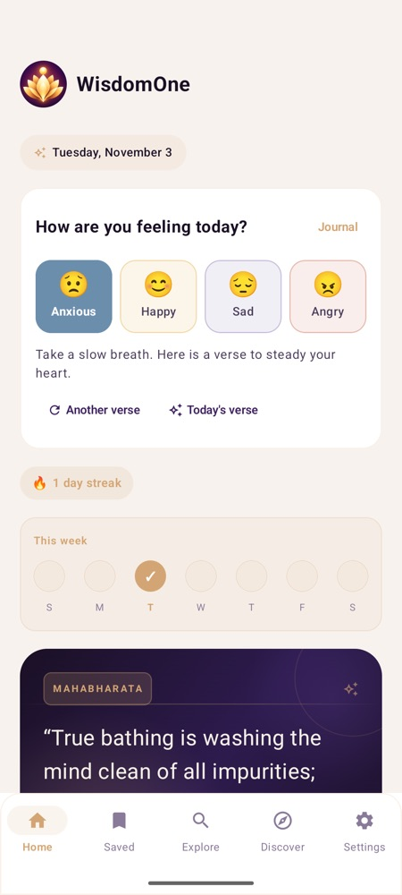<br/><sub><b>Mood check-in</b></sub></td>
    <td align="center"><br/><sub><b>Explain like I'm 5</b></sub></td>
    <td align="center">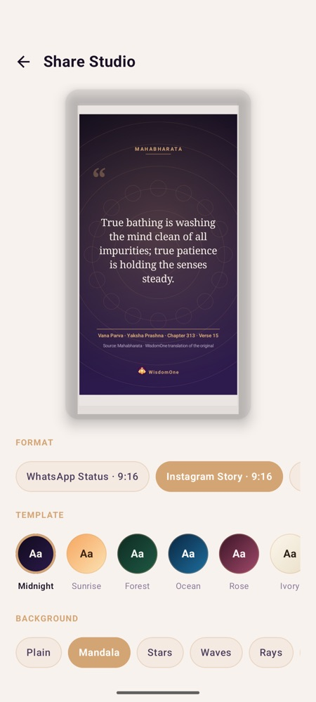<br/><sub><b>Share Studio</b></sub></td>
    <td align="center">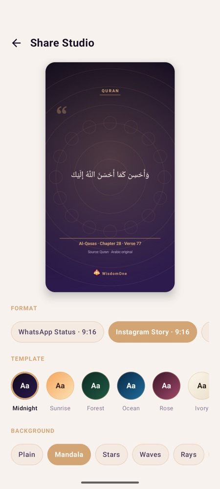<br/><sub><b>Arabic (RTL) card</b></sub></td>
    <td align="center">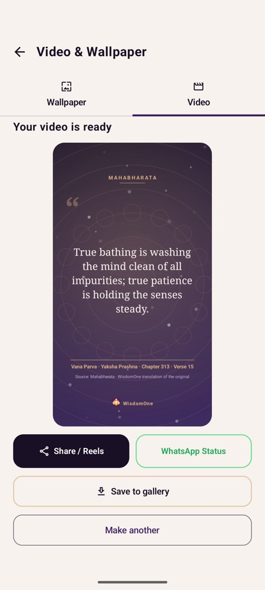<br/><sub><b>Verse video</b></sub></td>
  </tr>
  <tr>
    <td align="center">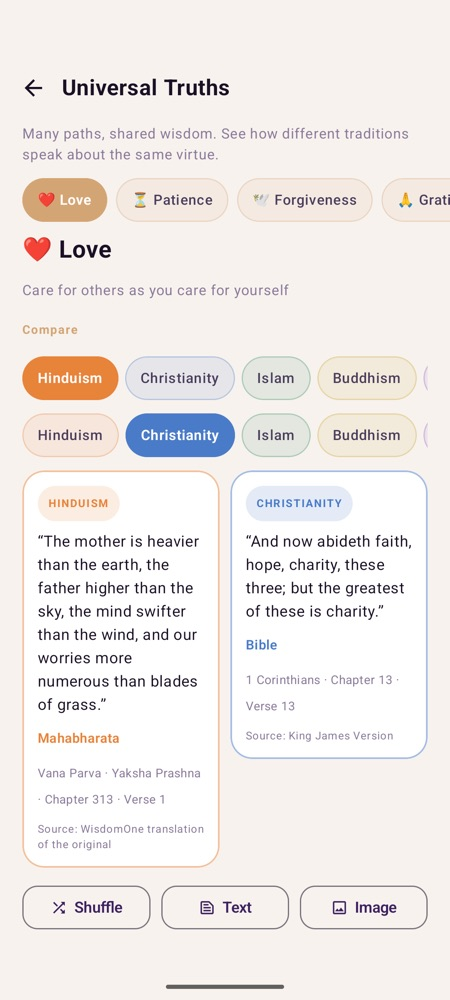<br/><sub><b>Universal Truths</b></sub></td>
    <td align="center">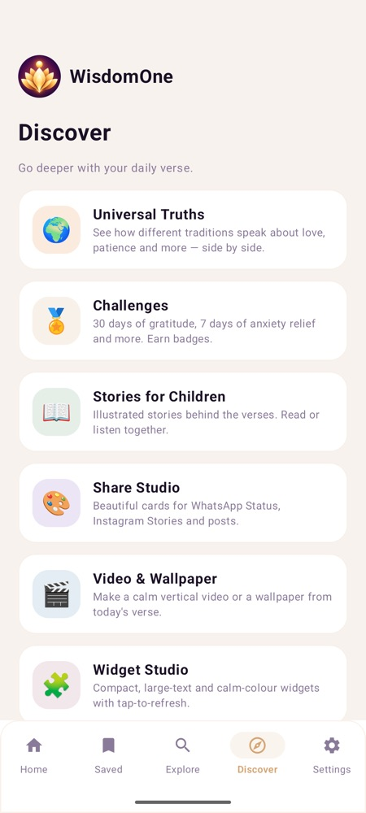<br/><sub><b>Discover hub</b></sub></td>
    <td align="center">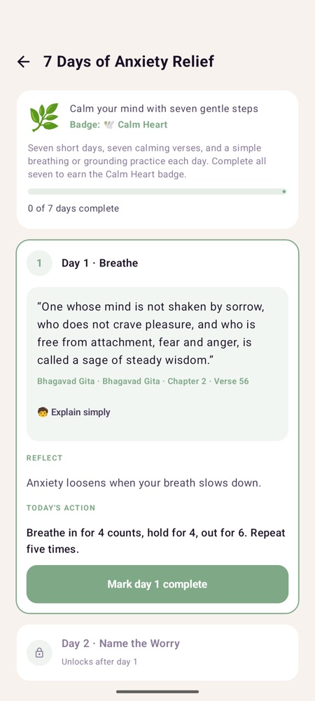<br/><sub><b>Challenge day</b></sub></td>
    <td align="center">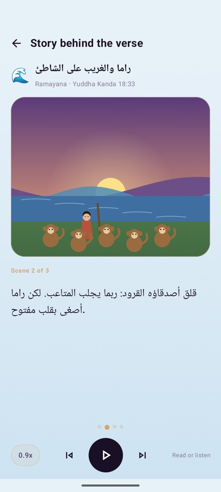<br/><sub><b>Story (Arabic)</b></sub></td>
    <td align="center">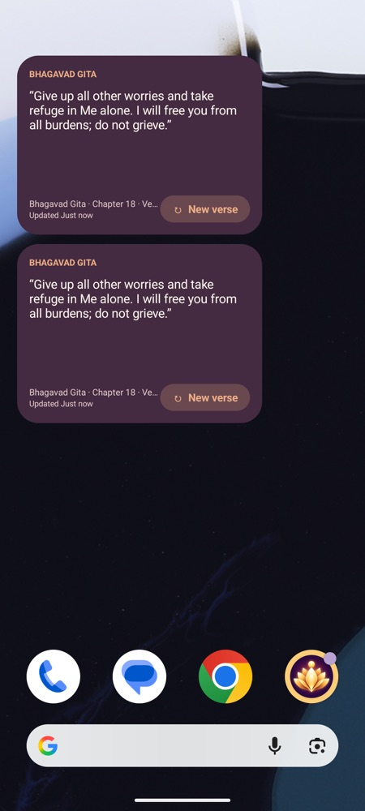<br/><sub><b>Widgets</b></sub></td>
  </tr>
</table>
</div>

## 📚 Verse catalog

The SQLite database ships **663 authentic verses**. Every scripture × language combination has **30 or more** records, each with topics, mood tags and a simple explanation.

| Scripture | 🇬🇧 en | 🇮🇳 hi | বাং bn | 🇪🇸 es | ع ar | اردو ur | ไทย th |
|---|:---:|:---:|:---:|:---:|:---:|:---:|:---:|
| **Bhagavad Gita** | 30 | 30 | 30 | | | | |
| **Ramayana** | 30 | 30 | 30 | | | | |
| **Mahabharata** | 30 | 30 | 30 | | | | |
| **Bible** | 31 | 31 | | 31 | | | |
| **Quran** | 30 | 30 | | | 30 | 30 | |
| **Dhammapada** | 30 | 30 | | | | | 30 |
| **Inspirational Verses** *(Vedas, Upanishads, Tao Te Ching, Analects, Tirukkural)* | 30 | 30 | 30 | | | | |

**How the content is sourced**

- Original texts (Sanskrit, Pali, Arabic, Hebrew/Greek, classical Chinese/Tamil) are in the public domain. The English Bible is the public-domain **King James Version**. Other renderings are WisdomOne's own plain-language translations of those originals, and every row records its `source`, `translation` and `license`.
- Nothing is paraphrased and passed off as scripture; the earlier demo paraphrases were removed.
- Content lives in [`backend/app/content/`](backend/app/content) and is synced by an idempotent, versioned seeder. Verse IDs (and therefore saved favourites) are preserved wherever the reference is unchanged.

> **Before a public release:** Ramayana and Mahabharata sarga/adhyaya/shloka numbers follow commonly cited numbering and are best-effort (the *Yaksha Prashna* rows use serial numbers) — please verify them against a critical edition. Hindi, Bengali, Urdu, Thai and Spanish renderings and the story texts should be proofread by native speakers.

## 🚀 Quick start

### 1 · Backend (FastAPI + SQLite)

```bash
cd backend
python3 -m venv .venv && . .venv/bin/activate     # Windows: .venv\Scripts\Activate.ps1
pip install -r requirements.txt
uvicorn app.main:app --host 0.0.0.0 --reload
```

The API creates / upgrades `scripture_daily.db` on start-up (safe, non-destructive) and seeds the catalog. Open **http://localhost:8000/docs** · health check: `/api/v1/health`.

<details>
<summary><b>PostgreSQL with Docker</b></summary>

```bash
# put strong SD_JWT_SECRET and SD_ADMIN_TOKEN values in backend/.env first
docker compose up --build
```

Compose runs PostgreSQL 16 and persists data in the `postgres-data` volume. For non-SQLite databases apply Alembic revisions (`alembic upgrade head`) before production use.
</details>

### 2 · Android app

Requirements: **JDK 17**, **Android SDK 36**, and a `google-services.json` for package `com.scripturedaily` in `android/app/` (git-ignored — any Firebase config works for local builds).

```bash
cd android
./gradlew assembleDebug
adb install -r app/build/outputs/apk/debug/app-debug.apk
```

The emulator reaches the API at `http://10.0.2.2:8000/api/v1/`. For a physical device add your computer's LAN address to `android/gradle.properties`:

```properties
SD_API_BASE_URL=http://192.168.1.20:8000/api/v1/
```

<details>
<summary><b>Release build</b></summary>

Chucker (the HTTP inspector) is a `debugImplementation` dependency, so release builds contain only its no-op stub. Create a keystore once, keep it **out of version control**, then:

```bash
./gradlew assembleRelease     # APK  → app/build/outputs/apk/release/
./gradlew bundleRelease       # AAB  → app/build/outputs/bundle/release/ (Play Store)
```

Before publishing: set `android:usesCleartextTraffic="false"`, point `SD_API_BASE_URL` at an HTTPS endpoint, add a privacy policy and crash telemetry, and rotate any development secrets.
</details>

## 🏗 Architecture

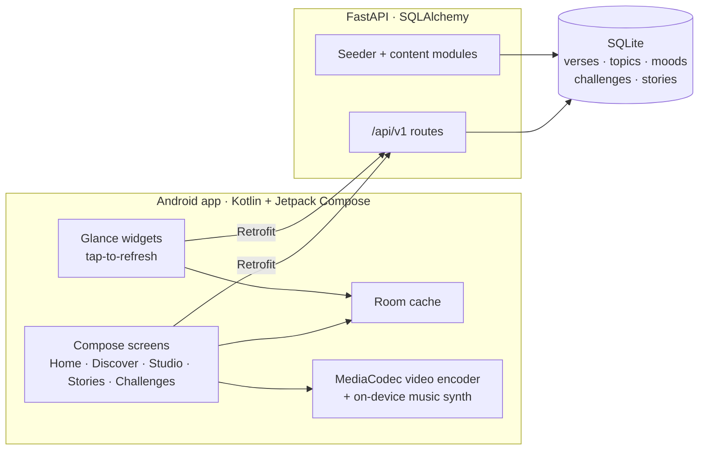

<details>
<summary><b>Data model</b></summary>

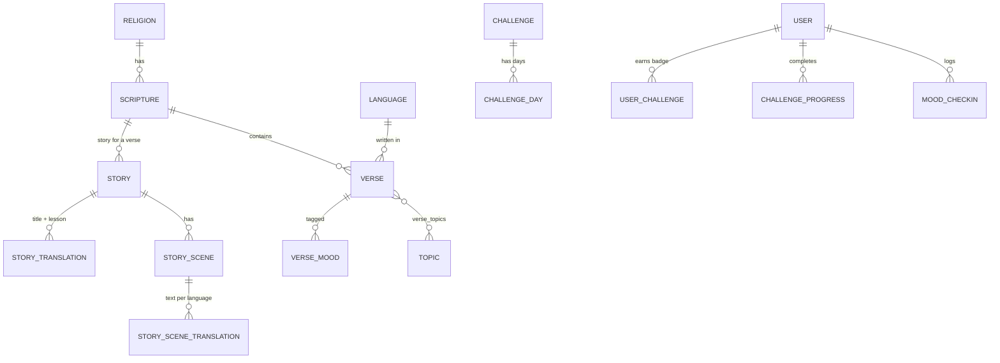
</details>

<details>
<summary><b>Project layout</b></summary>

```text
backend/
  app/
    api/v1/        routes.py (core) · features.py (moods, truths, challenges, stories)
    content/       gita.py · ramayana.py · mahabharata.py · bible.py · quran.py
                   dhammapada.py · wisdom.py · stories.py · challenges.py
    models/        SQLAlchemy entities          schemas/   Pydantic models
    seed.py        idempotent, versioned catalog sync
  alembic/         migrations (0003 adds the v2 tables)
  tests/           14 API tests
android/app/src/main/java/com/scripturedaily/
  MainActivity.kt  app shell, navigation, Home
  data/            Retrofit API, Room cache, workers
  features/        mood · truths · share · media · challenges · story · explain · discover
  widget/          four Glance layouts + Widget Studio
  ui/              shared theme and overlay components
docs/              screenshots, banner, privacy policy
```
</details>

### Notable design choices

- **Per-language content, one reference.** A verse is the same reference in every language; topics, mood tags and the simple explanation travel with each language row, so *Universal Truths* and *mood* queries work in any language and fall back to English only when a tradition has nothing in yours.
- **No licensed media.** The calm music is synthesised on the device (sine pads, soft bells, drones) and encoded to AAC; story illustrations are vector art generated from tokens stored in the database.
- **Widgets stay live.** The widget observes the stored verse, so the ↻ button updates it instantly — from the network when online, from cached verses when offline.
- **Safe upgrades.** Existing SQLite databases are migrated in place; legacy demo rows that match an authentic reference keep their IDs, so saved favourites survive.

## 🔌 API reference

Interactive docs at `/docs`. All routes are under `/api/v1`.

<details open>
<summary><b>Core</b></summary>

| Method | Route | Purpose |
|---|---|---|
| GET | `/religions`, `/languages`, `/scriptures` | Browse the catalog |
| GET | `/verses/today`, `/verses/random`, `/verses/{id}` | Verse delivery (`random` accepts `exclude_id`) |
| GET | `/verses/search?q=` · `/verses/today/history` | Search and recent verses |
| GET | `/scriptures/{id}/chapters[/{n}/verses]` | Chapter browser |
| POST | `/auth/register`, `/auth/login` | Create account / sign in (JWT) |
| GET/PUT | `/users/preferences` | Read / update preferences |
| GET/POST/DELETE | `/favorites` | Saved verses |
| POST | `/devices`, `/feedback` | Device registration, feedback |
| POST | `/admin/verses` | Publish a verse (`X-Admin-Token`) |
</details>

<details open>
<summary><b>v2 features</b></summary>

| Method | Route | Purpose |
|---|---|---|
| GET | `/moods` · `/mood/verse` · `/mood/summary` | Mood list, mood-matched verse, journal summary |
| POST | `/mood/checkins` | Log a mood check-in |
| GET | `/verses/{id}/explain` | "Explain like I'm 5" text |
| GET | `/universal-truths/topics` · `/universal-truths/{topic}` | Cross-tradition comparison |
| GET | `/challenges` · `/challenges/{id}` | Tracks, days and progress |
| POST | `/challenges/{id}/join` · `/challenges/{id}/days/{n}/complete` | Join / complete a day |
| DELETE | `/challenges/{id}/progress` | Start over (earned badges are kept) |
| GET | `/users/badges` | Earned badges |
| GET | `/stories` · `/stories/{code}` · `/verses/{id}/story` | Children's stories |
</details>

## ⚙️ Configuration

| Variable (`SD_` prefix) | Default | Meaning |
|---|---|---|
| `DATABASE_URL` | `sqlite:///./scripture_daily.db` | SQLite, PostgreSQL or MySQL URL |
| `JWT_SECRET` | *dev value* | **Change before deploying** |
| `ADMIN_TOKEN` | *dev value* | Protects `/admin/verses` |
| `CORS_ORIGINS` | `*` | Comma-separated allowed origins |
| `CHALLENGE_ONE_PER_DAY` | `true` | Allow only one new challenge day per calendar day |

## 🧪 Testing

```bash
cd backend && pytest -q                # 14 tests
cd android && ./gradlew testDebugUnitTest
```

The API suite checks the core flows, that **every scripture × language combination has at least 30 verses** (and every mood, in every combination, at least 3), explanations, Universal Truths (including language fallback), the full challenge → badge flow with the one-day-per-day rule, and every story in every language.

The app was also exercised end to end on a Pixel 7 emulator (API 37): onboarding, mood selection, Explain, Share Studio (share + save), video generation (H.264 720×1280 + AAC verified), wallpaper preview, Universal Truths, completing a challenge day, a story with read-aloud, widget placement and tap-to-refresh, and an Arabic right-to-left card.

## 🗺 Roadmap & known limitations

- Account sign-in and server-synced favourites are not exposed in the app UI yet (a device identity is used silently).
- Push notifications (FCM) are not configured; reminders use WorkManager.
- Read-aloud depends on the text-to-speech voices installed on the device (Hindi, Bengali, Urdu, Thai may need a voice download).
- Lock-screen widgets require a device whose lock screen hosts widgets; availability varies by Android version and manufacturer.
- Planned: more stories and challenge tracks, an admin console for content, scholar-reviewed epic citations.

## 🙏 Credits

Built on the original *Scripture Daily* starter by **Dipankar Dandapat**. WisdomOne v2 adds the mood, comparison, studio, challenge, explanation, widget, video and story features, the authentic verse catalog, and the extras listed above (Mood Journal, "unlocks tomorrow" challenge state, Universal Truths share image).

Sacred texts belong to humanity: the Sanskrit, Pali, Arabic, Hebrew, Greek, Chinese and Tamil originals are public domain, and the King James Version is public domain. Please keep the `source` and `license` metadata accurate when adding content.

<div align="center"><sub>Take a breath. Carry the thought with you. 🪷</sub></div>
