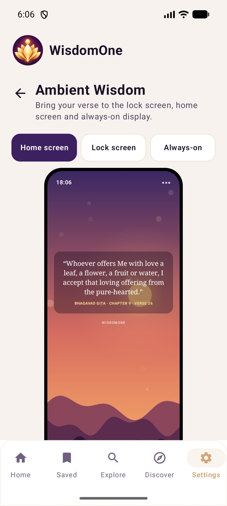
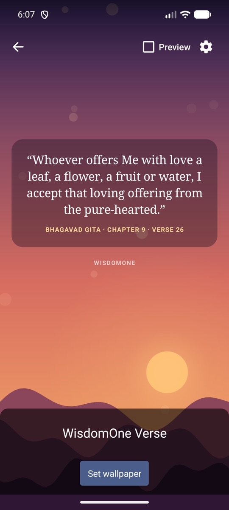
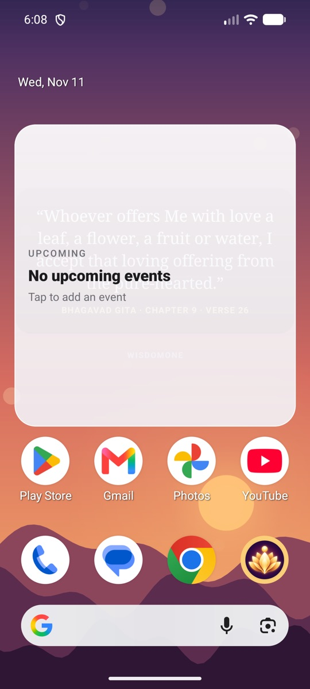
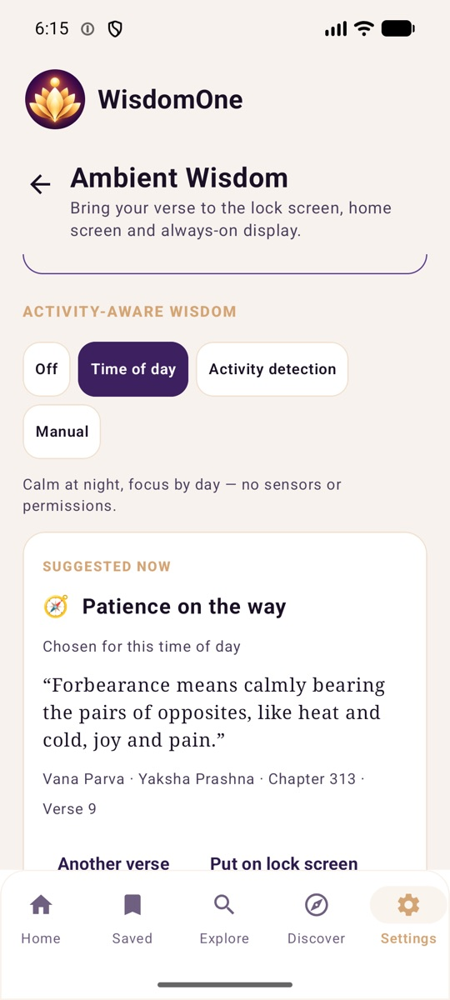
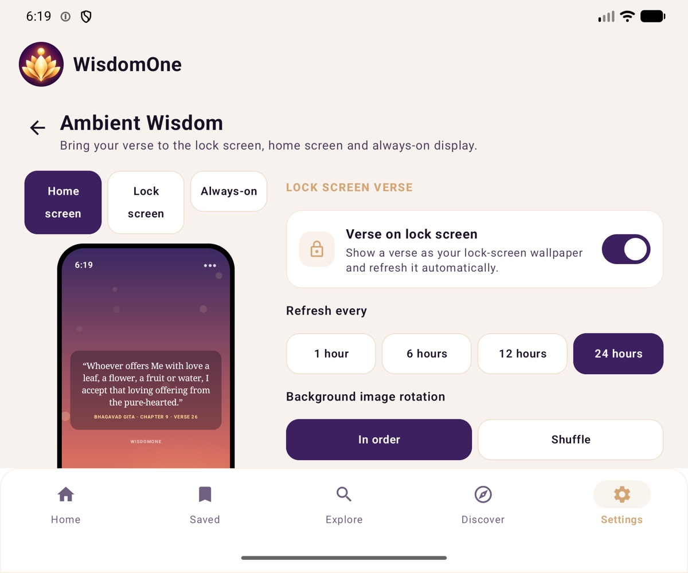

# WisdomOne — Ambient Wisdom Layer

Brings the daily verse outside the app: lock screen, home-screen live wallpaper, an always-on-display-friendly one-line
notification and optional activity-aware suggestions. Everything lives under **Settings → Ambient Wisdom**.

| Settings | Live wallpaper (system preview) | On the home screen | Activity-aware suggestion | Unfolded / tablet |
|---|---|---|---|---|
|  |  |  |  |  |

## What already existed and is reused (not duplicated)

| Existing piece | Reused for |
|---|---|
| `LockScreenVerse` (bitmap renderer + `WallpaperManager.FLAG_LOCK`) | lock-screen verse, styles, contrast panel, artwork packs |
| `VerseSyncWorker` (WorkManager, 1 / 6 / 12 / 24 h) | verse refresh frequency — the Ambient screen edits the same `frequency` preference |
| `lock_screen` preference + Home/Settings toggles | "Verse on lock screen" switch |
| Widget cache (`widget_text`, `widget_reference` …) | the single local source for the live wallpaper and ambient notification — **no extra API call per frame or refresh** |
| `GET /universal-truths/{topic}` | verses for activity-aware categories |
| `GET /api/v1/app/config` | server kill switches (`ambient_wisdom.*`) |

## Features

### 1. Lock-screen verse
- On/off, refresh frequency (1 / 6 / 12 / 24 h), visual style (links to the existing Lock Screen & Wallpaper designer).
- **New: background image rotation** — *In order* or *Shuffle*. Both show every image of the tradition's 20-image pack
  once before any repeats; shuffle uses a new seeded permutation per cycle and never shows the same image twice in a row
  across cycles (`AmbientWisdom.imageFor`, unit-tested).

### 2. Activity-aware wisdom (optional)
Modes: **Off** (default) · **Time of day** (no sensors) · **Activity detection** · **Manual**.

| State | Category | Universal Truths topic |
|---|---|---|
| Walking | Energy & motivation | hope |
| Running / cycling | Strength & perseverance | courage |
| Sitting or working (day) | Focus & wisdom | wisdom |
| Still at night / resting | Peace & calm | peace |
| In a vehicle | Patience on the way | patience |

- Uses Google Play services **Activity Recognition Transition API**: event-driven, no polling, no location, no
  foreground service. `ACTIVITY_RECOGNITION` is requested **only** when the user selects *Activity detection*; denial
  falls back to *Time of day* with an explanation.
- Only the latest activity type + timestamp is stored, in app-private preferences. Nothing is uploaded. A detection
  older than 3 h is ignored. Registrations are restored after reboot (`BootReceiver`).
- It **recommends a category**; it never swaps the verse by itself. The user can show a matching verse and, if they want,
  put it on the lock screen.

### 3. Always-On Display
Android has **no universal third-party AOD API** (each manufacturer controls its own AOD). WisdomOne only uses supported
capabilities:
- an optional **one-line ambient verse** notification: `IMPORTANCE_LOW`, silent, ongoing, `VISIBILITY_PUBLIC`, a ≤ 60
  character excerpt cut on a word boundary. It appears on the lock screen everywhere and on the AOD on devices that show
  notifications there (e.g. many Samsung / Motorola models). It is re-posted only when the verse changes — no background
  work of its own;
- the Settings screen explains this honestly and shows an *illustration* of the AOD;
- burn-in: the AOD itself is drawn by the system (which shifts pixels); our content is a single short grey line.

### 4. Live wallpaper (`VerseLiveWallpaperService`)
- Generative sky by time of day: **Morning** sunrise gold, **Afternoon** bright nature, **Evening** sunset, **Night**
  deep blue with twinkling stars — or a fixed theme. Slowly drifting motes of light, a breathing sun / moon and three
  parallax hills that also follow launcher page swipes.
- Verse on a translucent panel in the upper-middle third (clear of the clock and dock), auto-shrinks to fit, never cut.
- Battery: draws **only while visible**, ~12 fps on a hardware canvas with cached shaders, paths and text layouts;
  *Still* motion and **Battery Saver** draw a single frame (refreshed every 15 min for the time-of-day mood).
- Preview & apply through Android's own live-wallpaper preview (`ACTION_CHANGE_LIVE_WALLPAPER`); the in-app preview uses
  the same renderer. The lock-screen verse (`FLAG_LOCK`) and the live home wallpaper coexist.

### 5. Foldables, edge-to-edge, "Dynamic Island"
- Ambient settings switch to **two panes** (preview | settings) at ≥ 600 dp (unfolded foldables, tablets); the wallpaper
  re-lays out on every surface change (fold / unfold / rotate).
- The app already draws edge-to-edge (`enableEdgeToEdge`) and uses a navigation rail at ≥ 840 dp.
- No System UI modification and no Dynamic-Island imitation. The Android-supported equivalent is the ongoing ambient
  notification (status-bar icon + one line). Android 16 "Live Updates" are reserved for progress-centric activities
  (rides, deliveries), which a daily verse is not, so they are intentionally not used.

### 6. Backend
- No new tables. Server kill switches in the existing config document:
  `ambient_wisdom: {live_wallpaper_available, activity_aware_available, ambient_notification_available}` — a `false`
  hides that section in the app without a release.
- User choices stay on the device (they only affect this phone's surfaces), so no new preference API was needed.

## Permissions added
| Permission | When | Why |
|---|---|---|
| `ACTIVITY_RECOGNITION` (API 29+) / `gms…ACTIVITY_RECOGNITION` (≤ 28) | only on selecting *Activity detection* | activity transitions |
| `BIND_WALLPAPER` (service protection, not requested from the user) | — | live wallpaper service |

`POST_NOTIFICATIONS` (already used) is requested when the ambient verse is switched on, if not yet granted.

## Testing done
| Area | Result |
|---|---|
| Unit tests (`AmbientWisdomTest`) — rotation no-repeat (6 cycles × 3 seeds), themes by hour, activity mapping, stale fallback, topic codes exist, excerpt | ✅ pass |
| Android 17 (API 37) emulator, Pixel 7 profile | ✅ settings screen, live wallpaper preview → *Set wallpaper* → active (`dumpsys wallpaper` shows our component), time-of-day suggestion + verse fetch, activity permission deny → fallback and allow → registered, ambient notification posted with `vis=PUBLIC`, importance LOW |
| Unfolded foldable size (2208 × 1840) | ✅ two-pane layout |
| Older Android | builds for `minSdk 26`; APIs used are guarded (`lockHardwareCanvas` falls back to `lockCanvas`, mutable PendingIntent only on 31+, permission name per API level) |
| Offline | live wallpaper and ambient notification read only the local cache; suggestions show a connection message |

Not verified on hardware: real activity transitions (the emulator does not generate them) and manufacturer AOD rendering.
